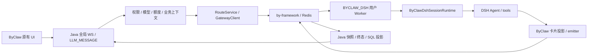
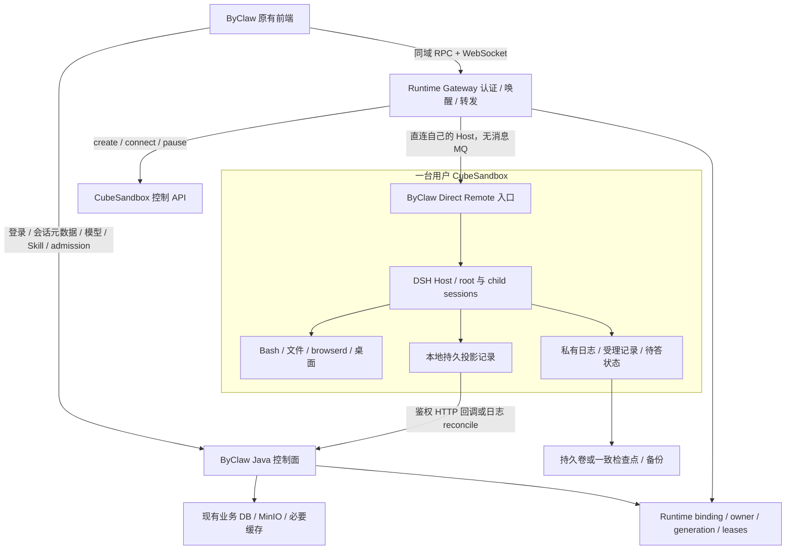

# ByClaw 保留前端、直连 DSH 与 CubeSandbox 改造研究

2026-10-14 · 深入源码调研与建议设计 · 尚未实现或部署。

## 结论

建议采用 **ByClaw 原有 UI + ByClaw 业务控制面 + 同域 Runtime Gateway + 每用户 CubeSandbox 内 DSH Host**。浏览器的命令和实时输出直接到自己的 DSH，网关只做认证、唤醒与路由；不再用 Redis Streams/NATS 传递这条 Chat 链路。DSH 原始会话日志是新会话的运行事实源，ByClaw 数据库存账号、权限、业务元数据与可重建的消息投影。

这是可以实施的方向，但不是更换一个 WS URL：当前前端使用 ByClaw 特有卡片协议，Java 和 Harness 的消息入口包含模型、额度、员工、群任务、附件与交互上下文。最适合的改造是复用现有 DSH 核心及 ByClaw UI，在二者之间补业务与展示适配。[B][H]

首版建议 **DSH、Bash/文件、browserd、Chromium/桌面共同在一台用户 Cube 内**，日常闲置使用 pause/resume。多个会话共享该用户实例；跨用户依靠 PVM 隔离。常驻 A +按需工具 B 仍可无 MQ，但当前 Harness 大量使用本机工具、UNIX socket 与桌面，因此拆分 A/B 会扩大迁移面。[H][C]

## 1. 调研基线与证据边界

| 项目 | 指定版本/来源 | 本次检查的固定提交 |
|---|---|---|
| ByClaw | 本地 `origin/D0.6.0` | `bf6a9c54bf7456c29c2e7c19b6b9a13ed82de3bf` |
| byclaw-harness | 本地 `origin/2026.9.8` | `1fd4c59e3a97f03e19f40bd32eb6e819d91f42ea` |
| DSH 核心 | Harness 默认基础构建引用 `dsh-v0.1.5-rc.2` | `fb2c4b9e698e30edb738bca4cf0618587db7d203` |
| Grok 重建源码 | 本地 tracked source | `a9f633e09d49a85829b8236331b9e21f7e612634` |
| CubeSandbox | 官方固定版本文档 | `v0.7.2` |
| 已有 Cube/DSH 实验平台 | 生命周期实现与既往报告 | `28902afab692a2b4d44b084f5d7a86632a068c4a` |

ByClaw 与 Harness 均在原来的 main 工作区保持不变，指定版本通过 Git archive 读取。两次远端刷新遇到网络错误，**以上是本地跟踪分支的固定提交，不保证此刻远端最新**。未安装依赖、启动产品、重启服务器或运行新的端到端测试。Grok 的附件是本地未提交的分析 HTML，作为线索重新核对源码；重建源码和未提交的 `sand-host` 运行包不混为一个官方版本。[G]

四份详细证据笔记：

- [B：ByClaw 当前数据路径与前端协议](byclaw-direct-dsh-current-system.md)。
- [H：Harness 与对应 DSH 核心](byclaw-harness-direct-dsh.md)。
- [G：Grok Host 直连参考与保证边界](grok-direct-host-reference.md)。
- [C：Cube 接入落点与生命周期](cubesandbox-byclaw-lifecycle.md)。

下文 `[B/H/G/C]` 指向上述精确源码行号索引；无此类标记的 API 名、组件名、阶段安排是本次提出的设计，尚不存在于代码中。

## 2. 当前链路：需要替换什么



FE 的 `useSend.ts` 实际发送全局 WS 的 `LLM_MESSAGE`，`chatStream.ts` 期待 `CHAT_STREAM` 中的 `answerStart/Delta/End`、`reasoningLog*`、`appStreamResponse` 等。`useChat` 的恢复调用 Java `runningStatus/runningSnapshot`，序列比较适配 Redis Stream ID；不会自动理解 DSH 原生快照。[B：§1–2]

Java 的 `AssistantChatService`/`RouteService` 处理 session 写权限、模型与思考强度、额度、资源解析、群任务 guard、attachments/cwd、trace、answer ID。Harness 的 `SessionRuntime.ask` 还做员工/组/计划/问答与 `byclaw/session-setup`。将消息绕过这些入口会让“能回答”与“业务权限正确”脱节。[B：§3][H：现有消息入口]

因此需替换的是 **传输、运行态恢复来源、沙箱 provider与 lifecycle**；保留并抽出 **业务 admission、Agent运行、展示投影、平台业务 API**。

## 3. 目标架构：直连数据面，保留业务控制面



“直连”指浏览器的 Chat 数据面直达 DSH，不经过 worker queue。公网仍有同域认证和路由代理，这是身份与唤醒边界；不把 Cube 管理 Key、traffic token 或 DSH 通用管理 token 发给浏览器。

可第一阶段在 Java gateway模块实现代理，减少新增部署组件；若连接规模要求更独立的数据面，再抽出轻量 Runtime Gateway。两种方式都不经 Java `ChatService` 逐条解析/转发 Agent输出，也不创建新的 stream middleware。代理本身仍需背压、帧限额、WS upgrade 和撤权关闭，不能把现有 120s HTTP代理直接当长期WS。[C：§1]

逻辑 binding 以平台可信 owner scope、适用的 enterpriseId、USER owner的 userId及 serviceKey为依据；不接受客户端选 sandboxId/Host/IP。实例规格、模板版本是 deployment配置；扩缩容/升级改变 generation，不更换逻辑会话身份。当前个人 HARNESS映射到 `byclaw-dsh` 的用户实例可沿用；企业共享Host是另一项权限设计，不用个人Host的全局control baseline直接广播给多人。[B：§3][H：控制状态][C：§1]

同一授权安全域的多个会话共享OS用户、文件与运行环境，cwd只是工作路径，不是安全隔离。一个平台用户进入不同企业安全域时，binding必须包含企业/scope，按需独立Runtime；不能把不同企业的凭证一起注入一个用户沙箱。恢复后先刷新授权/configVersion再放行，长期平台登录token与Cube管理密钥不进入工具进程环境；业务凭证按实际工具范围下发。[H：H7、H12][C：§3]

## 4. Grok 可以借鉴什么

Grok 的 renderer 连接本地 coordinator，coordinator用控制面 `ensureSandBox` 获取 gateway descriptor，再直连 sandbox Host。`POST /api/sendPrompt` 发命令，`GET /events` SSE收更新；Agent与工具在同一个盒子，掉线不停止Agent。这证明“运行时自主执行+客户端重连”不依赖外部 Chat MQ。[G：S2–S8]

但有四个具体差异：

1. Grok gateway明确拒绝 browser Origin。桌面 bearer连接不能照搬到Web；ByClaw需要浏览器可信的同域入口。[G：S4]
2. Grok SSE没有逐事件 cursor replay，重连靠对话状态重新读取；DSH已有更合适的 snapshot/seq接口，应该复用。[G：S7–S8][H：U2]
3. Grok `accepted:true` 存在非持久降级，ledger写失败也可能继续；不用于承诺“已发送必定在崩溃后可恢复”。[G：S9–S10]
4. Grok loopback `hibernate()`只清窗口cache，真实Cube休眠仍需我们实现。多屏幕不等于多租户执行隔离。[G：S14–S16]

保留的是结构和职责分工，具体 transport优先使用DSH已有协议，不复制Grok的接口名字或持久性缺口。

## 5. 前端：保留界面，替换 transport与状态适配

建议增加 `ChatTransport`，统一 `connect/prepare/send/subscribe/history/cancel/respondInteraction`，按会话 `runtimeBackend` 选择 `LegacyChatTransport`或 `DshChatTransport`。全局平台 WS继续收通知、任务计划等；DSH Chat命令/更新由独立Runtime连接承担。[B：§1–2]

`DshChatTransport`复用固定版本的：

- `@deepseek-ai/dsh-client-connection/client`。
- `@deepseek-ai/dsh-api-gateway/client`。
- `@deepseek-ai/dsh-api-session-controller/client`。

上游已有React独立client导出、HTTP RPC与 `/api/remote.mux`，native `session.page/follow/control`、prompt/cancel等方法。实际Umi打包、registry版本与base path还需spike；不要从另一个repo直接import内部源码，使用固定版本包或本项目构建出的版本化client产物。[H：U1、U6–U7]

展示层使用一个共享 `DshToByClawProjection`，复用Harness现有 `byclaw-presentation.ts`与FE消息块契约。**实时事件和历史快照使用同一投影规则**，避免刷新后工具卡/思考/结果变形。可逐步把纯函数抽成版本化schema/package，避免跨产品源代码耦合。[B：§2][H：H4–H5]

| 数据/动作 | 现有 UI 需要保留 | 改造重点 |
|---|---|---|
| text / reasoning | 正文、thinkText与状态 | 区分临时preview与持久settlement；不要token到来就改写最终事实 |
| tool start/result/error | toolCall卡、顺序、展开结果 | stable toolCallId、parent session/run；非只显示工具名 |
| plan / child Agent / task | 当前计划、子会话/任务卡 | root/child映射与独立终态，子完成不结束父会话 |
| question / approval | 原有问答/审批卡 | pending action持久ID与服务端ownership；回答/拒绝为独立操作 |
| files / diffs / downloads | 附件、diff、工作区/产物 | session ACL、路径约束、artifactID映射；最新workspace操作需ensure |
| queue / stop / jobs | 排队、停止、后台任务 | native取消默认保留inbox，需单独实现“清排队”；job脱离前台仍需work lease |
| history / reconnect | 刷新恢复、分页、跨标签 | native序列契约替代Redis ID比较；snapshot基线完整替换后再应用增量 |

上述功能在存量项目里已有展示或业务语义，具体DSH字段对照与每类卡片fixture属于下一阶段设计验收。[B：§2][H：现有消息入口与协议]

## 6. Harness：保留核心，拆出可信直连入口

建议Integration组合成四块：

1. **ByClaw control client/catalog**：资源授权、员工/组、模型、业务API与配置版本。
2. **ByClaw session业务适配**：员工、群任务、cwd/attachments、plan/问答/工具与 `session-setup`。
3. **ByClaw Direct Remote**：可信请求、幂等受理、控制命令与会话订阅。
4. **Legacy Redis Worker**：暂留用于灰度与未迁移执行引擎，DSH直连会话不启用该收发路径。

`ByClawDshCommandHandler`已有session port；`WorkerRunner/GatewayDataEmitter`是要卸下的传输依赖。拆成 `RuntimeEventSink`/持久projection输出端口，`SessionRuntime`不再知道Redis Worker的生命周期。[H：H3–H5]

推荐在上游 Remote注册体系加 `byclaw` namespace，**先复用/抽出业务setup再调用DSH Session/Agent服务**。浏览器的执行命令只走这个可信入口；不能一面做prepare-turn，另一面仍开放未经平台额度/模型校验的裸 `session.prompt/selectModel/create`写入口。读接口只暴露映射后的session，并保留owner过滤。

这样可复用native历史/follow/control，而不是同时运行两套Agent loop，或让legacy worker和direct入口竞争同一会话。实施时保证同一个root identity只由一个模式写入，灰度字段写在会话/owner路由，而非只隐藏前端按钮。

## 7. 受理与恢复：移除 MQ 后仍需明确合同

上游native prompt的requestId去重查看inbox和user/message log；HTTP accepted发生在followup/steer后，没有在该入口显式等待fsync。实时assistant preview是cursorless、process-local，durable event才具备恢复依据。[H：U2–U4、U8]

建议新增受理记录：`(owner, externalSessionId, requestId, inputDigest, preparedConfigVersion, state, durablePosition)`。`requestId`与网络RPC ID分开；同键同内容返回原结果，同键不同内容拒绝冲突。admission确认先写可靠存储；存储不可写不得显示“已发送”。具体用DSH日志+flush扩展或嵌入持久ledger实现，需强杀探针选择最小可行方案。

接口候选，不代表已实现：

```text
POST /byaiService/chat/prepare-turn
  -> 权限/额度/模型/资源/附件检查，冻结可信上下文
  -> 返回不含秘密的单次admission凭据与runtime路由

ByClaw Direct Remote: admit / requestStatus / cancel / respondInteraction
  -> 验证admission范围、digest与generation
  -> 唯一DSH Session/Agent writer

DSH Remote: page / follow / control（受owner映射约束）
  -> opening snapshot + durable seq +临时preview
```

丢失提交响应时先查requestStatus，不换新requestId盲发。受理成功后尚未开始的输入需要在restart时调和；已执行外部副作用但结果未知的工具不能自动整轮重放。这是可恢复性设计，**不承诺跨模型/工具的exactly-once执行**。

恢复使用DSH现有 `(durable Session address, throughSeq)`；进程/路由generation用于过滤旧控制连接，不能把每次resume误当成durable日志序列归零。每次follow接收opening快照与连续seq，gap触发重新sync；durable log被替换/回退时明确lineage/resync，不能套用旧Redis `timestamp-seq` comparator。[H：U2、U8][B：§2]

断开页面仅退订。native `session.cancel`才取消Agent，且保留inbox；UI提供停止当前轮次、清排队消息两个明确动作。冷重启时问题/审批/job的内存状态不自动恢复，需要持久pending action或明确unknown/expired。热暂停不代替这项验收。[H：U9、H9]

## 8. 数据权威与平台业务投影

新会话保持一个DSH原始事实源；Java SQL保存浏览历史、收藏/反馈/分享/审计、业务任务状态等投影。外部ByClaw session/message数字ID映射到DSH UUID/event position，映射一次并持久化。原有SQL历史继续只读可访问，旧会话默认legacy transport；不要直接伪造旧数据为DSH日志。

平台投影不能由浏览器回传的最终答案驱动：浏览器离线时Agent仍执行，而且客户端不可信。由Runtime记录本地持久projection outbox，直接向BE发送scoped鉴权HTTP，BE幂等upsert；失败保留本地游标待重试，控制面可按durable position reconcile。这个outbox是本地应用记录，不是新部署的消息队列中间件。[B：结果投影][H：持久输出]

热Runtime实时从DSH读；睡眠时列表/已完成历史/已发布产物从平台投影读取，显示projection waterline/同步状态。需要最新状态、继续发送、终端/桌面或workspace文件时才ensure。分享/评论权限仍由BE控制。单靠终态callback无法覆盖进程崩溃前的输入/中间状态，必须有可重建的运行事实及reconcile策略。

冻结与备份应包含profile/plugin storage、原始session logs、受理ledger、pending action、workspace与browser profile；模型/业务credential需独立权限与加密，不能把恢复卷共享给其他用户。停止写入后做一致backup/manifest；任意热tar不构成SQLite/WAL或多数据目录一致性证明。[G：S15][C：§5]

## 9. Cube 接入的具体工程落点

| 范围 | 现有落点 | 建议变更 |
|---|---|---|
| provider选择 | `SandboxAutoConfiguration` | runtime provider配置脱离file.storage.type，灰度Cube/旧provider |
| Cube生命周期 | `SandboxRuntimeProvider`、`StandardSandboxLifecycleService` | Cube client/provider、pause/connect/state/epochs、durable binding；支持reusable paused实例 |
| spec转换 | `GenericSandboxSpecProcessor`、`SandboxRuntimeRequestFactory` | image→已构建Cube template；env/resources/volume/port/network逐项转换；模板READY门槛 |
| 镜像 | Harness `Dockerfile.base/Dockerfile/docker-entrypoint.sh` | 按固定DSH及插件patch构建，保留UID/socket/supervisor/browserd/bycli；兼容envd/启动契约 |
| ingress | `SandboxIngressRuntimeSupport`、HTTP transport | Cube route/traffic header在服务端注入；nativeWS独立代理；files/VNC同owner授权 |
| readiness | `SandboxService` endpoint/worker ready | Cube RUNNING + DSH API版本/owner/generation +业务catalog +browserd readiness；不等待Redis Worker上线 |
| idle清理 | `SandboxService.cleanupExpiredSandboxes` | Cube分支drain/flush/pause，去掉自动DELETE；旧provider保持原路径 |
| 心跳/自启动 | `useHeartbeat`、`SandboxLoginAutoStartService` | presence和work lease分离；默认登录不唤醒DSH，warm pool为可选策略 |
| files/jobs | `SandboxCommandExecutor`、Fs/artifact服务 | run/start/inspect/output/cancel/文件仍是provider能力，不捆到Chat WS；旧句柄generation失效 |
| 租户身份 | `SsSandboxRecord`与缓存/锁key | USER/TENANT owner边界贯通DB、binding、lookup、proxy、volume；不能只检查userCode |

源码依据与精确行号见[C：§1]与[B：§5]。当前锁释放GET比较后DELETE、Runtime state只有RUNNING/RELEASED语义等问题应在Cube生命周期切片中修正，而非把OpenSandbox请求JSON换个baseUrl。[C]

Java侧可选择薄REST `CubeSandboxClient`调用官方CubeAPI控制接口，把SDK/字段兼容限制在provider内；也可将SDK调用封装在现有部署工具进程。第一版优先一个控制层负责binding/lease，避免Java和Python各自建同一实例。是否引入SDK sidecar由pause/volume探针决定，不预设再增加常驻服务。

## 10. 唤醒、忙碌、休眠的应用合同

```text
UNALLOCATED → PROVISIONING → READY ↔ BUSY
READY → DRAINING → PAUSED → RESUMING → READY
任一步失败 → FAILED / RECONCILE_REQUIRED（保留原数据）
```

并发ensure对同binding合并一次创建/恢复；权限先查，恢复结束后再查。旧generation请求拒绝，控制面仅一个writer owner。注册ready不仅看VM状态，还需恢复数据、重连依赖及插件初始化成功。

work lease覆盖Agent推理、child run、排队但已受理输入、后台shell/job、文件写入/上传、PTY与实际桌面操作。等待审批/用户答复首版也阻止休眠，待pending action恢复机制完成后才优化。viewing presence与WS ping不永久保活，断网不结束work lease；失联lease不能凭TTL直接清除后暂停，先判断实际进程/owner并fence或人工调和。[H：H9、H14][C：§4]

drain必须和新的admission互斥：idle检测→暂停接受新工作/允许新请求撤销drain→确认work lease为零→flush原始日志与产物/一致checkpoint→再以generation+lease CAS核对→pause。失败则保留原实例，展示具体错误。初始300s idle只是实验平台可配置起点，须压测调优。[C]

官方 `v0.7.2` 支持VM pause/connect恢复，但外部socket需应用重连；物理资源释放与调度配额不同，释放比例越高，恢复越可能遇到容量不足。因此UI需“唤醒中/恢复失败/容量等待/已休眠”独立状态，不能用“排队中”覆盖一切。[Cube官方生命周期说明](https://github.com/TencentCloud/CubeSandbox/blob/v0.7.2/docs/guide/lifecycle.md)

**首版只暂停，不自动删除重建。** 当前实验A/B控制器的idle DELETE只恢复工具B workspace；整台DSH还有原始日志、inbox/问答、浏览器与业务权限上下文，不能直接套用。cold restore、跨节点、HA和灾备都需要独立验收。[C：§5–7][H：H9]

存储优先核对现有file/NFS/CephFS的POSIX能力；如继续S3 FUSE则本地POSIX工作目录+校验检查点。对accepted请求的持久性需要可靠state存储/及时同步，不能只等空闲归档。Volume是外部引用，snapshot/clone不复制它的数据，也不能当作租户副本。[Cube官方卷语义](https://github.com/TencentCloud/CubeSandbox/blob/v0.7.2/docs/guide/volume-plugin.md)[C：§5]

## 11. 消息队列到底能省到哪一层

| 范围 | 目标与阶段 |
|---|---|
| DSH主Chat命令与实时流 | 第一阶段从by-framework worker/Redis stream移除；不部署NATS/JetStream/Durable Streams |
| 多标签聊天订阅 | DSH私有Runtime直接支持多个subscriber，不经Java token广播 |
| 账号、资源、模型、auth cache/锁 | 继续使用平台存储/必要Redis；这是业务依赖，不能删Redis服务就结束迁移 |
| Integration资源变化、busy publisher | 分别改为版本化BE API/config refresh、直接RuntimeLeasePort，消除对Chat Worker存活的依赖 |
| 专家组中非DSH executor、DOC/ACP/外部Worker | 暂留旧传输并明确标注；最终要全执行链无MQ需HTTP/MCP/task admission+状态查询/cancel适配 |
| BY_SUPER/OpenClaw/企业Node | 独立运行分支，按后续切片迁移；首个HARNESS直连不代表这些已无MQ |
| Cube自身内部组件 | Cube官方实现仍使用Redis等控制面组件；省去我们的消息中间件不代表改写Cube内部实现 |

源码依据：[B：Redis分类表][H：H11–H14]；Cube内部依赖：[固定版本生命周期文档](https://github.com/TencentCloud/CubeSandbox/blob/v0.7.2/docs/guide/lifecycle.md)。

如果目标是最终ByClaw应用部署也完全无Redis，应另立一轮：模型/资源/授权配置走BE API，控制锁与runtime ownership走DB CAS，跨实例通知重新实现，并迁移所有executor。当前需求最直接的收益是删除DSH Chat中转链，避免继续引入新的stream service。

## 12. 建议实施顺序与验收门槛

| 阶段 | 交付的垂直切片 | 必须看到的证据 |
|---|---|---|
| 0 固定版本与接缝探针 | 实际Harness image digest/包清单；Cube模板；nativeclient Umi最小打包；projection fixtures | 对应核心版本、插件patch、template READY、HTTP/WS/auth/readiness；无真实模型也能测协议 |
| 1 个人HARNESS直连闭环 | 原ByClaw页面发送/思考/tool/历史/cancel，经可信入口与Cube，无DSH Chat MQ | 从真实平台登录→DSH→模型→Cube文件；刷新/断网继续；双标签与A/B用户隔离；幂等受理失败窗口 |
| 2 生命周期与数据恢复 | work lease/drain/pause/resume，投影reconcile，files/artifacts/pending action | 长推理/后台job不误暂停；无浏览器记录完成；睡眠读历史不唤醒；恢复旧session/文件/浏览器；checkpoint错误fail closed |
| 3 原产品能力对齐 | Skill/model/quota、计划/子Agent/审批/附件/diff、收藏分享、VNC/bycli/connector | 所有既有卡片fixtures +实际业务API权限；额度、模型切换、授权撤销和跨企业隔离 |
| 4 扩大去MQ范围 | 专家组/企业/定时任务与外部executor的直接协议 | 保留/替代功能清单全部通过；切断各legacy Worker消费并证明对应功能仍可用 |
| 5 冷恢复与规模 | DSH进程crash、PVM删除恢复、升级回滚、多节点/配额、backup/restore | request ledger/日志waterline与manifest一致，旧writer被fence，unknown副作用不重放；实测P50/P95/内存与snapshot成本 |

阶段1也需要最小lease保护，不能到阶段2才保护长运行；阶段2完善自动idle休眠与全恢复边界。生命周期入口及SQL字段变更属于真实migration，实施前需要用户指定migration版本；本次只描述逻辑模型，不创建DDL/DML。

首个可验收场景建议：“平台用户登录，选HARNESS员工，在原UI提问并写文件；关闭页面任务继续；重新打开读完整历史；空闲暂停；同会话恢复读取文件；另一用户无权读取/取消/下载”。随后用商业DeepSeek模型复跑，受控模型只证明协议与执行链，不能替代商业模型验收。

回滚以会话后端与owner灰度为单位：旧会话保持legacy；新direct会话若停用先停止admission、保留DSH日志/映射/投影，恢复路由不得将同一请求同时交给旧Worker。未完成数据迁移的新会话不要强行作为旧Worker会话继续执行。

## 13. 目前最需要探针回答的问题

- 实际用于部署的Harness镜像是否覆盖默认tag/依赖，以及model routing patch与client协议版本是否一致。
- ByClaw native Umi打包、Cordis client composition/base path、HTTP/WS与内部auth交换是否无隐式原生UI依赖。
- `SessionRuntime`业务setup和nativeSession接口怎样共用一份root/child生命周期，尤其群任务和ask_user。
- 数据后端是否提供DSH state需要的POSIX/fsync语义；S3 checkpoint时的恢复RPO与热pause配额成本。
- DSH/browserd/bycli/Redis/catalog timer在整个PVM暂停恢复后是否正确重连，pending交互与background process是否仍被lease识别。
- 企业sharedRuntime、外部executor/connector与定时任务的真实保留范围；这些需要独立验收，不能由个人聊天闭环推断。

这些是实施前要验证的技术边界，当前源码已经足以确定总体方向；本轮无需变更业务代码、现有部署或数据库。

## 14. 本轮文档核验

已核验HTML内嵌脚本可解析，全部本地文档链接存在，无外部运行依赖。浏览器检查390px移动宽度和1440px桌面宽度，文档宽度均不超过viewport；架构切换、闲置/检查点失败场景显示正确。另做Harness/core一致性只读复核，修正了“cwd隔离”表述。上述仅证明研究报告本身，不代表ByClaw端到端或Cube整机休眠已经通过。
