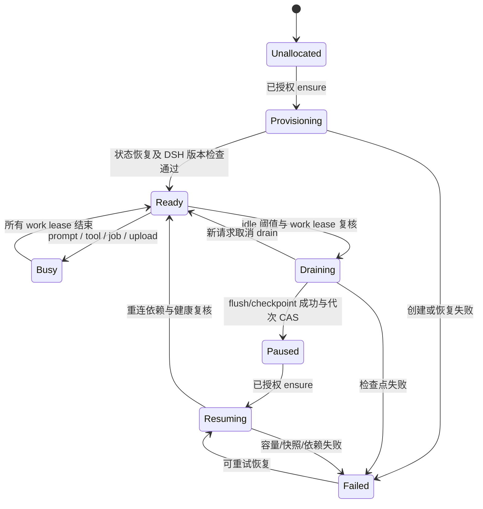

# CubeSandbox 接入 ByClaw：运行时、休眠与持久化依据

日期：2026-10-14。源码/官方固定版本文档研究，未修改业务代码，未执行新的 Cube API 或运行验收。

ByClaw 基线是本地 `origin/D0.6.0` 的 `bf6a9c54bf7456c29c2e7c19b6b9a13ed82de3bf`，远端 fetch 失败，最新 tip 未确认。Cube 依据固定 `v0.7.2` 的官方文档，不把 master 的新功能套到现有环境。已有实验平台基线 `28902afab692a2b4d44b084f5d7a86632a068c4a`，其历史验收只作技术参考，不能代替 ByClaw 验收。

## 1. ByClaw 已有扩展接缝，但 lifecycle 还不是 freeze/resume

下面 J 简写为 `byclaw-be/src/main/java/com/iwhalecloud/byai`，行号来自固定提交的只读归档。

| 源码 | 当前行为 | Cube 接入建议 |
|---|---|---|
| `J/gateway/sandbox/runtime/SandboxRuntimeProvider.java:16-57` | provider 提供 create、remove、heartbeat、get/list、endpoints；没有显式 pause/resume/drain | 增加 `CubeSandboxRuntimeProvider` 和独立 lifecycle 能力接口；不要把 pause 实现成 remove |
| `J/gateway/sandbox/config/SandboxAutoConfiguration.java:40-55` | 根据 `file.storage.type` 选择 WhaleAgent 或 OpenSandbox | 分离 `sandbox.runtime.provider` 与文件存储后端配置，Cube 不应强迫替换 MinIO |
| `J/gateway/sandbox/runtime/StandardSandboxLifecycleService.java:101-168` | spec→OpenSandbox shape request→findReusable/create→Redis 元数据 | Cube 独立转换 template/env/metadata/resources/volume 参数；保留元数据层，不照发旧 payload |
| 同文件 `282-302` | 缓存/创建锁按 userCode+sandboxType；释放锁是 GET 比较后 DELETE | 显式 owner scope/enterprise/generation；锁释放改原子 compare-and-delete，多副本 owner 用持久 CAS/fencing |
| `J/gateway/sandbox/service/SandboxLaunchContextFactory.java:127-156` | HARNESS→byclaw-dsh，多个员工可落同一个用户 runtime | 初期保留用户级 runtime；员工/会话是 DSH 中的身份与配置，不每会话建 PVM |
| `J/manager/entity/sandbox/SsSandboxRecord.java:24-43,63-83` | 已有 USER/TENANT scope、enterprise、service/profile，但状态注释主要 RUNNING/RELEASED | 增加运行状态与历史事实，不把 PAUSED 当作 RELEASED 或远端丢失 |
| `J/gateway/sandbox/service/SandboxService.java:524-559,599-602` | endpoint 轮询、worker readiness；超时仍可返回 endpoint | DSH 以版本/owner/generation/session readiness 为准；Cube 分支不再等待 Redis Worker 心跳 |
| 同文件 `1400-1438` | idle cleanup 调 `doRemoveSandbox` | Cube 分支改 draining→flush/checkpoint→pause；旧 provider 继续原策略 |
| `J/gateway/sandbox/service/SandboxLoginAutoStartService.java:58-86` | 登录可自动启动全部启用服务 | Cube DSH 默认按需，登录/菜单目录不应隐式唤醒；预热为显式可选策略 |
| `byclaw-fe/src/pages/sandbox/useHeartbeat.ts:7,28-48,59-75` | 可见页面每分钟 heartbeat，切回页面立即 heartbeat | UI presence 与 work lease 分开；状态查询不触发 ensure 或延长实际空闲期限 |
| `J/gateway/sandbox/service/ingress/SandboxIngressTransportService.java:38-55,62-85` | HTTP 代理丢弃 Upgrade，整体 call timeout 120s | native `/api/remote.mux` 必须 WS upgrade 代理；长连接独立超时、背压、帧限额 |
| `J/gateway/sandbox/service/ingress/openclaw/OpenClawWebSocketProxyHandler.java:64-84,187-205` | OpenClaw WS 上游 IP/port 来自路径，改写 Origin | 仅参考双向转发；DSH 上游必须来自已鉴权 binding，禁止浏览器任选 IP/port |
| `J/gateway/sandbox/service/ingress/SandboxIngressRuntimeResolver.java:14-24` | ingress 同样根据 file storage type 选择实现 | 单独 provider resolver + Cube ingress header 适配 |
| `J/gateway/sandbox/config/SandboxVolumeBackendValidator.java:40-79` | minio-mount/file，后者支持 bind/nfs/smb/cephfs | 审计现有 workspace path/FS 要求后选择 Cube 挂载，不能直接把 S3 当 POSIX |

## 2. 官方能力与应用保证的区别

官方固定版本 [lifecycle.md](https://github.com/TencentCloud/CubeSandbox/blob/v0.7.2/docs/guide/lifecycle.md#explicit-pause--resume) 描述 `pause()` 保存 VM 状态、`connect()` 恢复；`kill()` 删除实例和快照。其 `Operational Notes` 说明向外建立的 socket 需要应用重连。对应原文行号：135-170、248-250。

这支持把 DSH、浏览器、桌面、工具共同放进一台用户 PVM，但不意味着冻结后的模型 HTTP、Redis、平台 callback、WebSocket 自动继续有效。应用需要 reconnect hook、订阅重建与状态校验。**只有无进行中工作的安全点才允许主动休眠**，避免把 LLM 超时或工具副作用未知留给恢复阶段。

同文 `253-290` 说明物理 CPU/内存释放与调度配额释放不同，`paused_resource_release_ratio` 默认 0；磁盘与实例数仍消耗资源。若提高释放比例，恢复可能因容量不足返回 409。因此不能把“pause 支持”写成“任意规模用户都能立即唤醒”；需要容量/等待 UI 和恢复 admission 策略。

上述是官方能力说明；本次没有读取线上该配置，也没有测量 ByClaw 镜像的内存、snapshot 大小或唤醒时延。

## 3. 建议拓扑与状态机

首选一个 USER owner + 授权安全域 + DSH service 的逻辑 binding 对应一台 CubeSandbox，内部运行 DSH Host 和工具/浏览器/桌面服务。同一安全域的多个会话共享文件、OS 用户和运行环境，session与业务请求仍需单独鉴权；cwd不是文件或凭证安全边界。不同企业安全域应把enterprise/scope纳入binding，必要时独立实例，不能因平台user相同就共用企业凭证。TENANT共享runtime是后续独立切片，不直接复用个人Host的控制面全局视图。

`Failed` 不表示可删除原数据。丢失/损坏必须进入显式 reconcile，拒绝空目录“恢复”。第一阶段只 pause/resume，**不继承旧 PoC 的 idle pause 后 DELETE 逻辑**。删除重建是单独 cold-restore 合同。

ensure 必须在同逻辑 binding 下 single-flight，完成后重新检查平台权限；route generation 在持久控制面进行 CAS，旧 generation 的连接、写入票据和工具句柄失效。睡眠状态查询、索引读取、登录 heartbeat 不调用 `Sandbox.connect()`，因为 connect 本身会唤醒。

## 4. work lease 与休眠门槛

需要跟踪 prompt 从持久受理到终态、Agent/child Agent、background shell/job、PTY/desktop active operation、文件上传/写入，以及需要继续执行的 scheduled run。等待用户回答/审批可以按策略暂停，但必须持久化 pending action；首版先阻止休眠，不能只依赖内存 broker。

浏览器在线 presence 不是 work lease。WS/SSE 心跳只证明连接存活；页面 disconnect 只退订，不取消任务。后台任务完成后仍需本地记录终态并向平台投影，无浏览器时也不能丢结果。

drain 顺序建议：拒绝新 admission或让其撤销 drain → 汇总当前 work lease → 等待 journal flush/产物提交 → 数据库一致快照（如使用嵌入数据库）/检查点 → 再次用 generation + lease CAS 确认 idle → Cube pause → 发布 paused 状态。任何一步失败保留原实例及数据，不显示成功。

初始 idle 值可使用此前实验的 300s 作为可配置起点，**不是 ByClaw 压测结论**。同时避免 Cube 自动 pause 与业务 controller 竞争：首版明确由业务 controller 判定，使用 never-timeout 或明确配置防止默认 kill。后续采用 auto-pause 前必须证明活动任务的续租不会被网络空闲误判。

## 5. 持久化：热暂停、进程重启、删除重建分开验收

| 层 | 事实/建议 | 故障边界 |
|---|---|---|
| ByClaw DB | 用户、企业、会话元数据、资源/权限、业务投影、runtime binding | 不是 DSH 所有原始运行事件的第二写入权威 |
| DSH 私有 state/profile | 新会话原始 log、request ledger、pending action、configVersion、投影 outbox | flush 和备份策略需要与 workspace 一起协调 |
| Cube VM snapshot | 日常暂停后保留同实例的进程与 filesystem | 不代替异地备份；外部 socket 不能依赖原连接 |
| Cube Volume / POSIX storage | 跨实例的持久数据 | Volume 是外部引用，snapshot/clone 不复制其内容 |
| MinIO/artifact catalog | 已发布产物、旧会话文件、导出检查点 | 已发布产物可不唤醒；最新 workspace 文件操作要 ensure |

官方 [Volume 文档](https://github.com/TencentCloud/CubeSandbox/blob/v0.7.2/docs/guide/volume-plugin.md#snapshot-rollback-clone-and-cross-node-restore) 的 `550-561` 表明：外部卷的内容独立于 VM 快照，clone 可继续引用同卷，跨节点要求目标驱动/存储可用；不能把 clone 当成租户隔离副本。

对 ByClaw 建议优先核对其已经支持的 file/NFS/CephFS 后端，测试 git、pnpm、SQLite/WAL、rename、hardlink、文件锁后确定挂载 DSH state/workspace 的方案。当前 S3 FUSE 卷若继续使用，应采用本地 POSIX workspace + checksummed checkpoint；原始 state 的 durability 不得只等闲置时打包，需每次关键受理/终态同步到可靠后端。否则只承诺到最近检查点的恢复，不能承诺“已发送”输入在主机损失后仍在。

热暂停验收只说明同 PVM恢复。DSH 进程重启要求 pending input/ask_user/后台任务识别或 unknown 状态恢复。DELETE 后需权威数据归档、manifest/hash/version、原 writer fencing、完整恢复及路径校验；不能空实例替换同 logical binding。跨节点恢复和 HA 独立验收。

## 6. 已有平台哪些可复用，哪些不能直接拷贝

当前实验仓库 `/Users/xiaozhongcheng/data/company/dsh-cubesandbox-verify` 的固定提交 `28902af...` 提供源码参考：

| 文件与行号 | 可借鉴 | 不应直接套用 |
|---|---|---|
| `platform/runtime/lifecycle-ssh.mjs:102-110,159-199,218-238` | ensure 合并、句柄 generation、无自动副作用重放、work lease | 固定 DSH 0.2.1-alpha.2 的 SSH adapter，与 ByClaw 0.1.5-rc.2 不是同协议版本 |
| `platform/runtime/cube-manager.py:42-66,67-95` | restore_pending、checkpoint/hash、fail closed、volume binding | 当前只对工具 B 的 `/workspace` 打包；不是整台 ByClaw DSH state 的一致归档 |
| 同文件 `106-120` | reclaim 调和机制可作故障讨论 | 180s heartbeat stale/DELETE 的策略不能直接用于整台 DSH runtime；旧 writer 可能仍跑，需 fenced ownership |
| `platform/src/native-web.ts:56-78,130-135,295-334` | 每次 auth、cold boot 后 ACL复核、server binding、WS撤权关闭 | 原平台账号/DB不替代 ByClaw；HTTP 测试网关也不代表生产 HTTPS cookie/Origin配置 |
| `platform/RUNBOOK.md:32-38,64-76` | 数据与租约边界、常驻A/私有B限制 | A/B与单Cube两种拓扑不同，文本不唤醒B的验收不等于文本不唤醒整个DSH |
| `reports/platform/real-acceptance-latest.json:10-21`、`recovery-acceptance-latest.json:3-6` | 既往真实 B 文件隔离、暂停恢复、DSH 进程重启的记录 | 受控模型与旧平台测试，不是本次 ByClaw或商业模型验收 |

## 7. 最小运行验收计划

1. 同一用户两个页面同时 ensure，只创建/恢复一次；另一个用户不能读/取消/下载其 session。
2. 无工具的模型请求、长推理、Bash、background job、upload 期间跨 idle 阈值不暂停；断开所有浏览器仍执行并记录完成。
3. idle→pause→resume 后旧 session 继续、文件/浏览器配置正确，原连线失效且依赖重新连接；核对模型与资源授权版本。
4. CPU/内存 quota不足返回可解释等待/失败；不返回虚假 ready，不把容量失败变成再次创建。
5. drain时新请求、取消和权限撤销有明确结果；已受理同 requestId查询/重试无重复工具副作用。
6. checkpoint损坏/写失败/DSH崩溃时保持原权威数据；SQLite/WAL与硬链接探针通过；metadata缓存丢失可重建binding。
7. 旧 OpenClaw/BY_SUPER/企业分支仍按旧provider执行。DSH路径关闭Worker/stream消费后能完成端到端，不影响其他业务Redis用途。

以上为待执行的验收要求，未在本轮运行。
